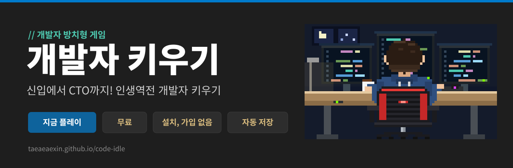
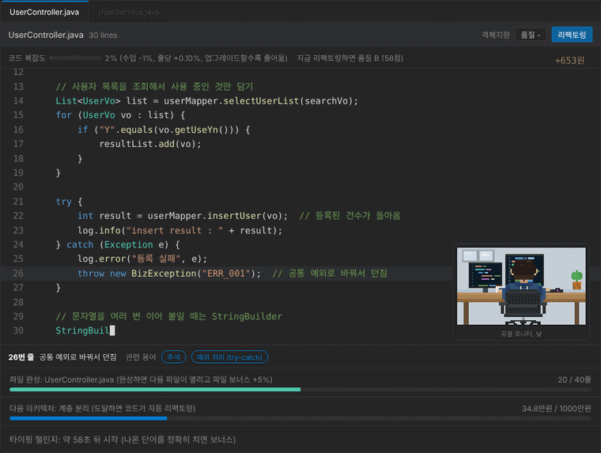
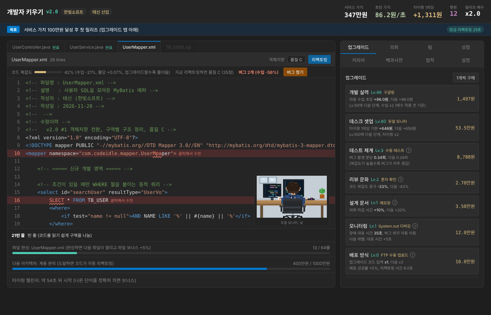
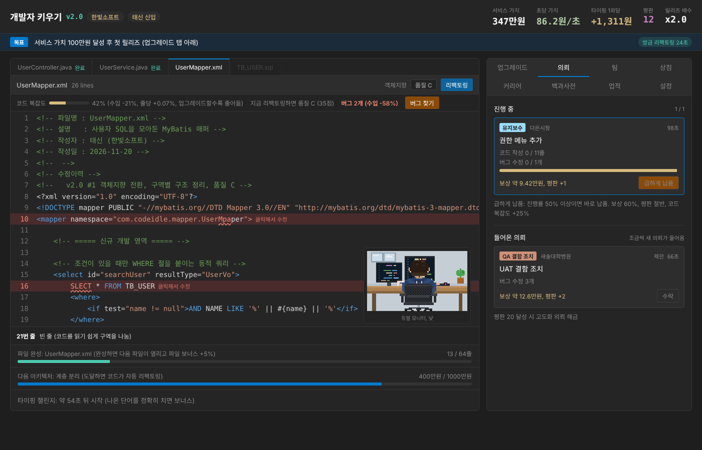
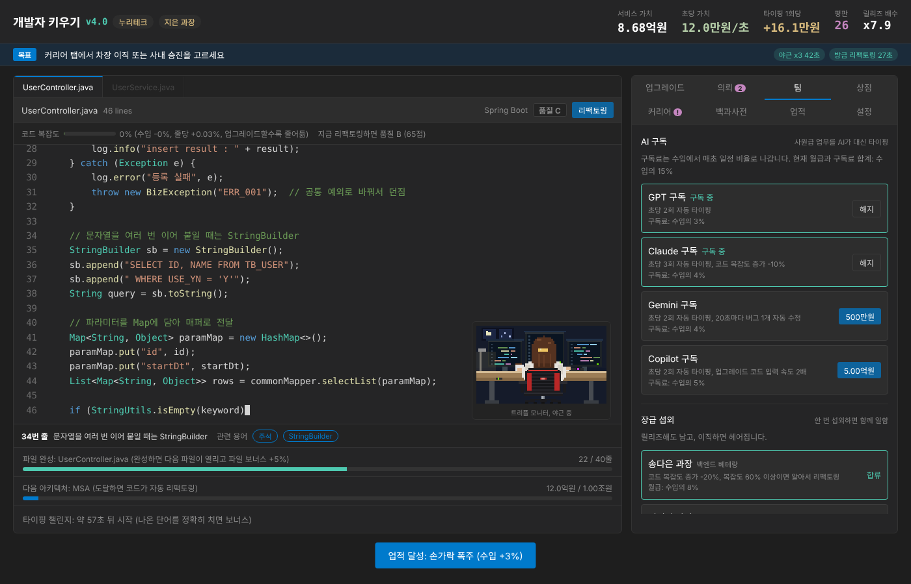
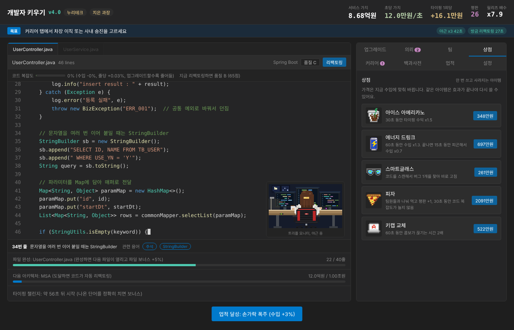
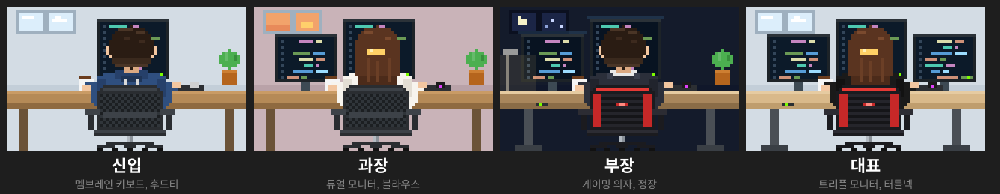
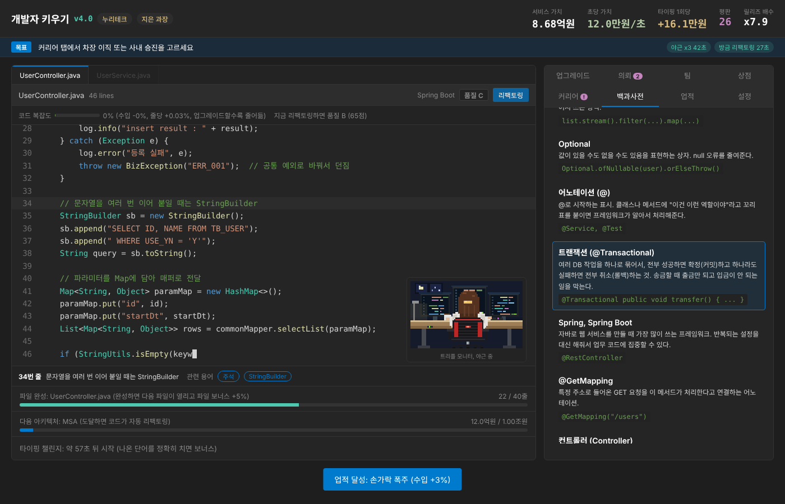

<a href="https://taeaeaexin.github.io/code-idle/"></a>

<h3 align="center"><a href="https://taeaeaexin.github.io/code-idle/">▶ 지금 바로 플레이하기</a></h3>
<p align="center">무료, 설치와 가입 없이 브라우저에서 바로. 진행 상황은 자동 저장됩니다.</p>

<p align="center">
  <a href="https://taeaeaexin.github.io/code-idle/"></a>
  
  
</p>

> 금요일 오후 5시, 고객사에서 연락이 왔습니다. "오늘 배포 가능하죠?"

**개발자 키우기**는 키보드를 두드려 코드를 쓰고, 그 코드로 돈을 벌어 신입 개발자에서 CTO나 대표까지 성장하는 방치형 웹 게임입니다.

<p align="center"></p>

## 작하기

1. **[게임 열기](https://taeaeaexin.github.io/code-idle/)** 후 이름, 캐릭터(남자, 여자), 회사 이름을 정합니다.
2. **아무 키나 누르세요.** 코드가 한 글자씩 쳐지고 돈(서비스 가치)이 들어옵니다. 휴대폰이면 에디터를 탭하면 됩니다.
3. 모은 돈으로 **업그레이드**를 사고, **의뢰**를 받아 납품하며 평판을 쌓으세요.

창을 닫아도 자리를 비운 동안 번 돈이 쌓여 있습니다.

## 이런 게임이에요

<table>
<tr>
<td width="50%"></td>
<td width="50%"></td>
</tr>
<tr>
<td><b>코드가 진짜로 쳐져요</b><br>Java, MyBatis XML, SQL, JavaScript, C# 파일을 차례로 완성합니다. 코드가 엉키면 오타 버그가 생기고, 빨간 줄을 클릭해 고쳐야 해요.</td>
<td><b>SI 현실 고증 의뢰</b><br>유지보수, QA 결함 조치, 신규 구축, 차세대 그리고 요구사항이 계속 바뀌는 진상 고객사까지. 마감을 넘기면 평판이 깎입니다.</td>
</tr>
<tr>
<td width="50%"></td>
<td width="50%"></td>
</tr>
<tr>
<td><b>AI 구독과 장급 섭외</b><br>GPT, Claude 같은 AI가 대신 타이핑하고, 백엔드 베테랑 과장, QA 리드, PM을 섭외해 팀을 꾸립니다.</td>
<td><b>개발자 밈 가득</b><br>금요일 배포, "제 PC에선 되는데요?", 운영 DB에 DELETE, 야근, 점심 메뉴 고르기. 아이스 아메리카노로 버티세요.</td>
</tr>
</table>

## 신입에서 CTO까지

<p align="center"></p>

| 단계 | 할 일 |
|---|---|
| 신입 | 타이핑으로 첫 파일 완성, 첫 의뢰 납품 |
| 릴리즈 | 서비스 가치 100만원을 넘기면 v2.0 릴리즈. 처음부터 다시 시작하지만 수입 배수가 붙어요 |
| 이직 또는 사내 승진 | 이직은 새 회사에서 리셋되는 대신 경력 포인트를 많이, 사내 승진은 그대로 유지하는 대신 조금 |
| 부장 이후 갈림길 | **이사 루트**: 리스크 없이 CTO까지 승진<br>**대표 루트**: 창업해서 매출 3배. 대신 시장 변동, 운영비, 세무조사, 해킹을 버텨야 하고 자금이 바닥나면 폐업 |
| 엔딩 | CTO 취임 또는 상장(IPO). 엔딩 뒤에는 보너스를 받고 다음 회차 시작 |

엔딩까지는 쉬지 않고 플레이하면 약 6시간, 방치형으로 즐기면 며칠 분량입니다.

## 하다 보면 개발 공부도 돼요

<p align="center"></p>

- 코드 줄에 마우스를 올리면 그 줄이 무슨 일을 하는지 설명이 나옵니다.
- 트랜잭션, JOIN, 인덱스, MyBatis 동적 SQL, async/await 같은 용어를 누르면 **백과사전**으로 바로 이동해요. 용어 60여 개가 들어 있습니다.
- 컴공 입문자, 막 입사한 신입 개발자, 개발 용어가 궁금한 기획자에게 추천합니다.

## 자주 묻는 질문

<details>
<summary><b>진행 상황은 어디에 저장되나요?</b></summary>

이 브라우저에 5초마다 자동 저장됩니다. 서버로 보내는 정보는 없어요. 다른 기기나 다른 브라우저에서는 처음부터 시작하고, 브라우저의 사이트 데이터를 지우면 기록도 사라집니다.
</details>

<details>
<summary><b>휴대폰에서도 되나요?</b></summary>

됩니다. 키보드 대신 에디터를 탭하면 코드가 쳐져요. 타이핑 챌린지처럼 키보드가 필요한 기능은 PC가 더 편합니다.
</details>

<details>
<summary><b>돈이 들거나 광고가 나오나요?</b></summary>

완전 무료이고 광고도 없습니다.
</details>

<details>
<summary><b>처음부터 다시 하고 싶어요</b></summary>

설정 탭의 "전체 초기화"를 두 번 누르세요. 엔딩을 봤다면 커리어 탭에서 보너스를 받고 다음 회차를 시작할 수도 있습니다.
</details>

## 친구에게 공유하기

게임 안 설정 탭에서 "내 기록 복사하기"를 누르면 직급, 작성한 코드 줄 수, 최고 서비스 가치가 담긴 문구가 복사됩니다. 아래 문구를 그대로 써도 좋아요.

```
개발자 키우기: 아무 키나 눌러 코드를 치고 신입에서 CTO까지 가는 방치형 게임
https://taeaeaexin.github.io/code-idle/
```

## 개발 정보

순수 HTML, CSS, JavaScript로 만들었고 빌드 과정이 없습니다. 도트 그림도 전부 코드(SVG)로 그렸어요.

```
index.html      화면 뼈대
css/style.css   스타일, 테마 4종
js/data.js      언어별 코드 생성 규칙, 업그레이드, 의뢰, 팀, 용어 사전
js/game.js      게임 로직, 화면, 도트 장면, 저장
docs/readme/    README 이미지
```

로컬에서 실행하려면 저장소를 받은 뒤 `index.html`을 브라우저로 열면 됩니다.

버그 제보와 아이디어는 [Issues](https://github.com/taeaeaexin/code-idle/issues)에 남겨주세요. 재밌게 하셨다면 ⭐ 하나가 큰 힘이 됩니다.
